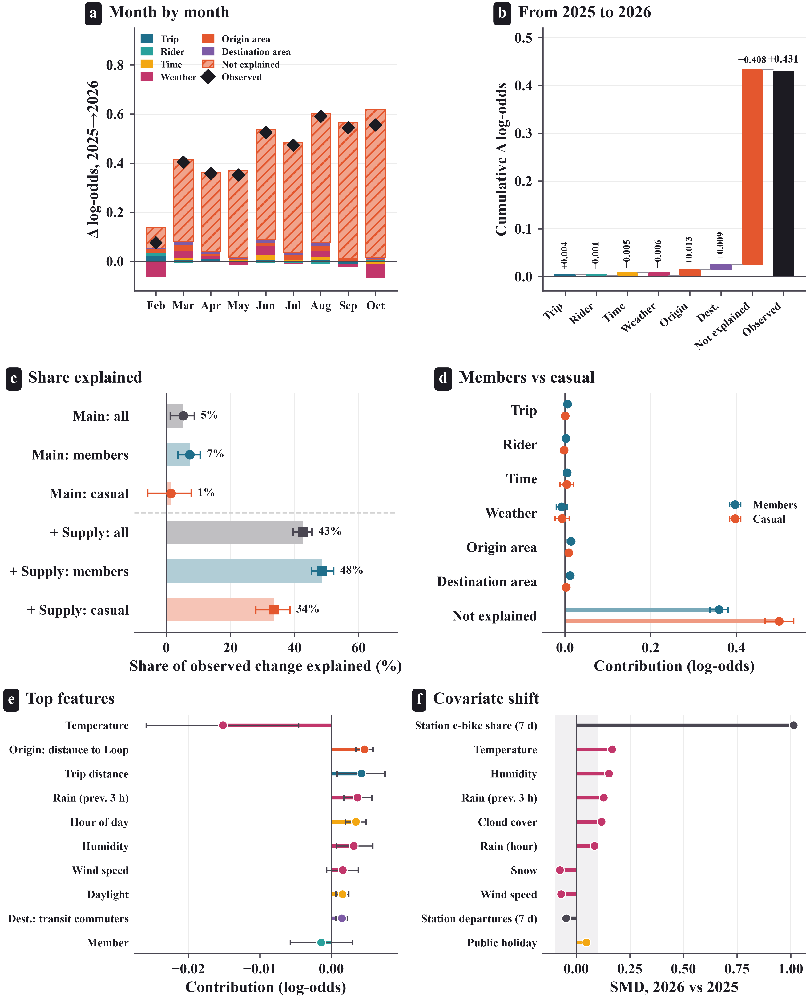

<div align="center">

# Same trips, more e-bikes

### Explainable artificial intelligence and the year-on-year shift in bike-share vehicle choice

**Divvy, Chicago · 6.8 million dock-to-dock trips · January 2025 to October 2026**


</div>

---

## Overview

Electric bikes now stand beside classic bikes at the same bike-share docks. This repository contains the complete, reproducible analysis behind the paper *Same trips, more e-bikes*, which asks two questions:

1. **What drives the choice** of an e-bike over a classic bike at a Divvy dock?
2. **Why did the e-bike share rise** by 10.7 percentage points from 2025 to 2026: because riders made different trips, or because they chose differently on the same kinds of trips?

Gradient-boosting models are trained on 2025, evaluated **once** on 2026 under a SHA-256 model lock, and explained with SHAP and accumulated local effects. A **season-matched drift decomposition** based on the exact additivity of tree SHAP values splits the change in e-bike choice into the part explained by trip, rider, weather and location mix and the part that reflects a change in the choice itself.

<div align="center">

<br><sub><b>Season-matched decomposition of the 2025 to 2026 change in e-bike choice.</b> Only about 5% of the rise is explained by the mix of trips, riders, weather and places.</sub>
</div>

## Key findings

| | Result |
|---|---|
| Test discrimination (2026) | LightGBM AUC **0.648** (95% CI 0.645 to 0.651), 0.047 above a spline logistic regression |
| Calibration drift | Mean prediction 46.3% against an observed 56.6%; calibration intercept rose from 0.10 (January) to 0.65 (October) |
| Main determinants | Trip distance, rider type, temperature, start hour and centrality |
| Drift decomposition | Trip, rider, weather and location mix explain **5%** (95% CI 1 to 9%) of the 10.7-point rise |
| Changed response | Year-specific twin models lose 0.04 AUC across years; the cold-weather preference for e-bikes roughly halved |
| Practical remedy | A monthly intercept update lowers test log loss from 0.673 to 0.649 and removes most of the calibration error |

## Study design and leakage control

The analysis protocol ([`PROTOCOL.md`](PROTOCOL.md)) was fixed before modeling. Leakage is prevented by design, and every control is asserted in code:

- **Choice set.** Only trips that start and end at an official *classic* dock are modeled, so both bike types were available. Station type comes from the operator's GBFS feed, never from the observed bike mix.
- **Canonical station locations.** Classic bikes are recorded at fixed station coordinates and e-bikes at their own GPS fix. Every station therefore receives one canonical location (the median of all recorded coordinates, both bike types pooled), and all spatial features are built from these locations, so coordinate precision cannot reveal the outcome.
- **No post-choice variables.** Duration, speed, end time and end-of-trip parking type are never features.
- **Training-only preprocessing.** The correlation filter, imputation and scaling are fitted on training data only.
- **Strict temporal order.** Inner training, a seven-day embargo, validation, then a single locked test on 2026.

```mermaid
flowchart LR
    A[Divvy trip histories<br/>Jan 2025 to Oct 2026] --> B[Audit and cleaning]
    C[ACS, LODES, TIGER,<br/>ERA5 weather, GBFS] --> B
    B --> D[Canonical station locations<br/>classic dock-to-dock sample]
    D --> E[Temporal split<br/>train | embargo | validation | test]
    E --> F[Candidates and Optuna tuning<br/>on validation]
    F --> G[(SHA-256 lock)]
    G --> H[Single test on 2026]
    H --> I[SHAP, ALE, interactions]
    I --> J[Season-matched<br/>drift decomposition]
    H --> K[Twin models, seed refits,<br/>monthly updating policies]
```

## Repository structure

```
ebike-classic-choice-drift-chicago/
├── README.md
├── PROTOCOL.md                  analysis protocol, fixed before modeling
├── CITATION.cff                 how to cite this repository
├── LICENSE                      MIT (code)
├── requirements.txt             pinned Python dependencies
├── run_all.sh                   runs the full pipeline in order
├── configs/
│   ├── config.yaml              data sources, paths, audit limits
│   ├── study.yaml               temporal split, forbidden features, correlation filter
│   └── features.json            feature sets (written by step 05)
├── data/
│   ├── README.md                how to obtain every input (raw data are not redistributed)
│   └── context/policy_timeline.csv   operator price and fleet changes used to interpret drift
├── src/
│   ├── prep_01_data_audit.py ... prep_03_clean_and_features.py   data preparation
│   ├── step_03_station_features.py ... step_13_manuscript_tables.py   study pipeline
│   ├── common.py                paths, loading, metrics
│   └── fstudio.py, plots.py, plots_extra.py   figure design system
└── outputs/
    ├── tables/                  all result tables (CSV)
    ├── reports/                 split manifest, tuned parameters, test lock, robustness (JSON)
    ├── figures/{png,pdf}/       Figures 1 to 16
    └── manuscript_tables/       LaTeX tables generated from saved results
```

## Reproducing the analysis

**1. Environment** (Python 3.13)

```bash
python -m venv .venv
source .venv/bin/activate          # Windows: .venv\Scripts\activate
pip install -r requirements.txt
```

**2. Data.** Download the inputs listed in [`data/README.md`](data/README.md). Divvy trip files cannot be redistributed under the Divvy Data License Agreement, so they are not included here.

**3. Run** the pipeline from the repository root, in order:

| Step | Script | Purpose |
|---|---|---|
| 1 | `prep_01_data_audit.py` | Audit raw trip files (structure, missing values, plausibility flags) |
| 2 | `prep_02_external_data.py` | Census tracts, ACS 2019 to 2023, LODES 2022, hourly ERA5 weather |
| 3 | `prep_03_clean_and_features.py` | Clean trips, attach time, weather and tract context |
| 4 | `step_03_station_features.py` | Station type from GBFS, canonical station locations, dock-to-dock sample |
| 5 | `step_03c_supply_proxy.py` | Station supply proxy from strictly earlier days (extension model) |
| 6 | `step_04_descriptive_figures.py`, `step_04b_feature_correlation.py` | Figures 1 to 8 |
| 7 | `step_05_split.py` | Temporal split, training-only correlation filter, asserted leakage checks |
| 8 | `step_06_candidates.py --set main` (and `origin_only`) | Untuned candidate models on validation |
| 9 | `step_07_tune_and_refit.py --set main` (and `main_plus_supply`, `origin_only`) | Optuna tuning on validation, refit on 2025 |
| 10 | `step_08_test_once.py` | **Single** evaluation on 2026; refuses to run if any model file changed |
| 11 | `step_09_xai_locked.py` | SHAP, drift decomposition, ALE, interactions, permutation importance |
| 12 | `step_10_xai_refits.py` | Seed stability, year-specific twin models, monthly updating policies |
| 13 | `step_11_xai_figures.py`, `step_12_robustness.py` | Figures 9 to 16, robustness checks |
| 14 | `step_13_manuscript_tables.py` | LaTeX tables for the manuscript |

Or simply run `bash run_all.sh`. A full run takes several hours on a laptop; the test-set step can only be run once per set of locked models.

## Outputs and the manuscript

| Manuscript item | File |
|---|---|
| Figures 1 to 16 | `outputs/figures/png/Fig01_*.png` ... `Fig16_*.png` (PDF versions in `outputs/figures/pdf/`) |
| Figure captions | `outputs/figures/figure_captions.md`, `outputs/figures/figure_captions_xai.md` |
| Predictive performance | `outputs/tables/Table8_test_overall.csv`, `Table9_test_by_group.csv` |
| Drift decomposition | `outputs/tables/Table11_drift_decomposition.csv`, `Table11a_drift_summary.csv` |
| Stability and robustness | `outputs/tables/Table14a_seed_stability.csv`, `Table14b_twin_transfer.csv`, `Table15_rolling_refit.csv`, `Table16_robustness.csv` |
| Model lock | `outputs/reports/08_TEST_LOCK.json` (SHA-256 of every locked model) |

## Citation

If you use this code, please cite the paper and the repository (see [`CITATION.cff`](CITATION.cff)):

> Hassan, M. (2026). *Same trips, more e-bikes: Explainable artificial intelligence and the year-on-year shift in bike-share vehicle choice.* Manuscript under review.

## Data licenses

Divvy trip data are provided by Lyft Bikes and Scooters, LLC under the [Divvy Data License Agreement](https://divvybikes.com/data-license-agreement). Census data (ACS, LODES, TIGER/Line) are public domain. Weather data come from the Open-Meteo historical API (ERA5 reanalysis, CC BY 4.0). The code in this repository is released under the MIT License.

## Contact

Mahbub Hassan · [mahbub.fkta@gmail.com](mailto:mahbub.fkta@gmail.com)
